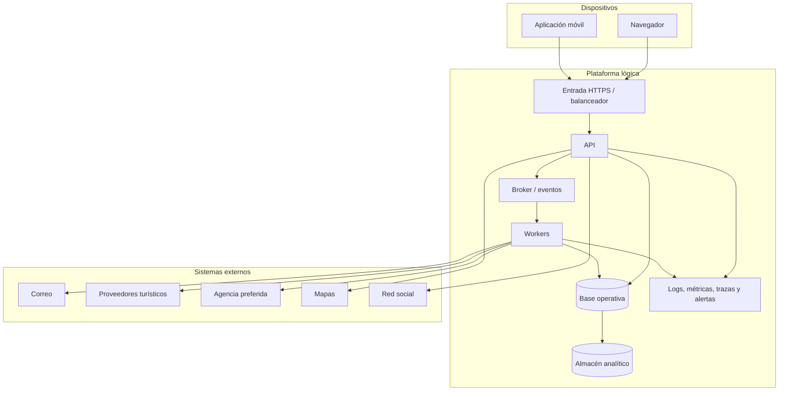

# Vista de asignación inicial — ADD-1

No se fija proveedor cloud, número de regiones, topología, motor de base de datos ni broker. La vista no demuestra el objetivo de disponibilidad: hacen falta pruebas de carga, fallo y recuperación.
