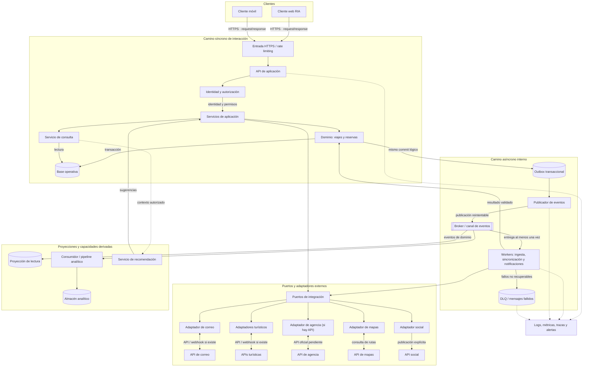

# Vista de componentes y conectores — ADD-1

La vista describe los principales componentes en tiempo de ejecución y los conectores entre ellos. Las flechas etiquetadas distinguen interacción síncrona, eventos internos y llamadas a terceros.

## Semántica de conectores y límites

- **HTTPS request/response:** consultas y comandos interactivos; errores de autorización/validación vuelven por el mismo canal.
- **Transacción + outbox:** el cambio de dominio y el evento pendiente se registran juntos; un publicador independiente reintenta su entrega.
- **Broker:** entrega al menos una vez; consumidores idempotentes evitan efectos duplicados. Los mensajes irrecuperables pasan a DLQ con alerta y reproceso controlado.
- **Integraciones externas:** el adaptador normaliza protocolo, errores, cuotas y credenciales. Webhooks solo se usan si la API los soporta; en caso contrario, un planificador consulta respetando cuotas.
- **Límites de confianza:** tokens y secretos quedan en almacenamiento protegido; los logs no incluyen credenciales ni contenido sensible de correos.
- **Despliegue:** los componentes son límites lógicos. No se impone un microservicio por componente; la topología física queda pendiente de pruebas de carga, costos y capacidad operativa.

La vista define mecanismos propuestos, pero no demuestra los objetivos de latencia, escala ni disponibilidad.
