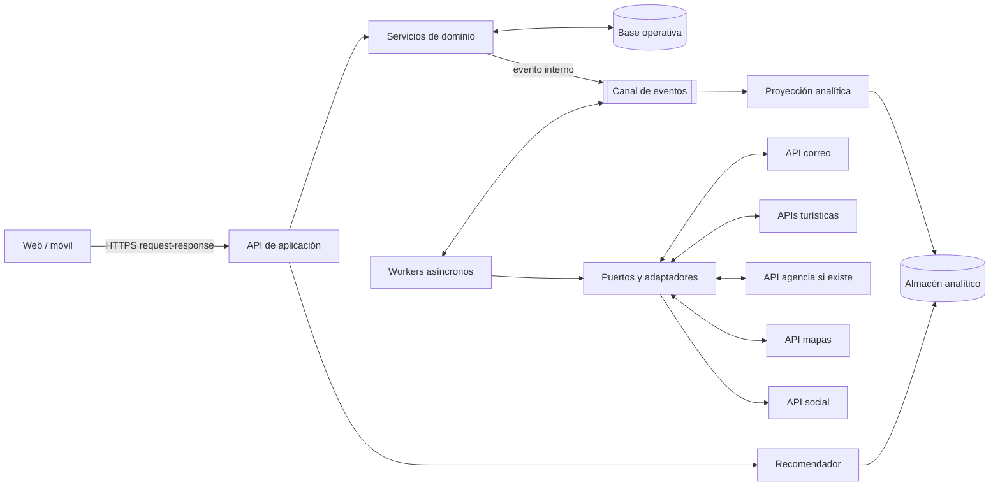

# Vista de componentes y conectores — ADD-1

HTTPS request-response sirve al usuario; eventos internos desacoplan procesamiento, reintentos y notificaciones. No se presupone que todos los proveedores externos emitan eventos. La entrega, idempotencia y DLQ se detallan en ADD-3.
