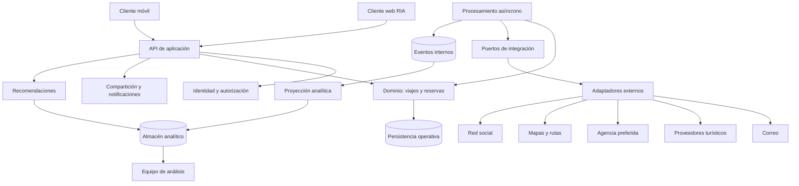

# Vista de módulos — ADD-1

Las cajas son módulos lógicos, no necesariamente servicios desplegables independientes.

El dominio no depende de SDKs externos. Analítica y recomendación acceden solo a los datos autorizados que necesitan. El despliegue físico se decidirá con evidencia de costo, escala y operación.
