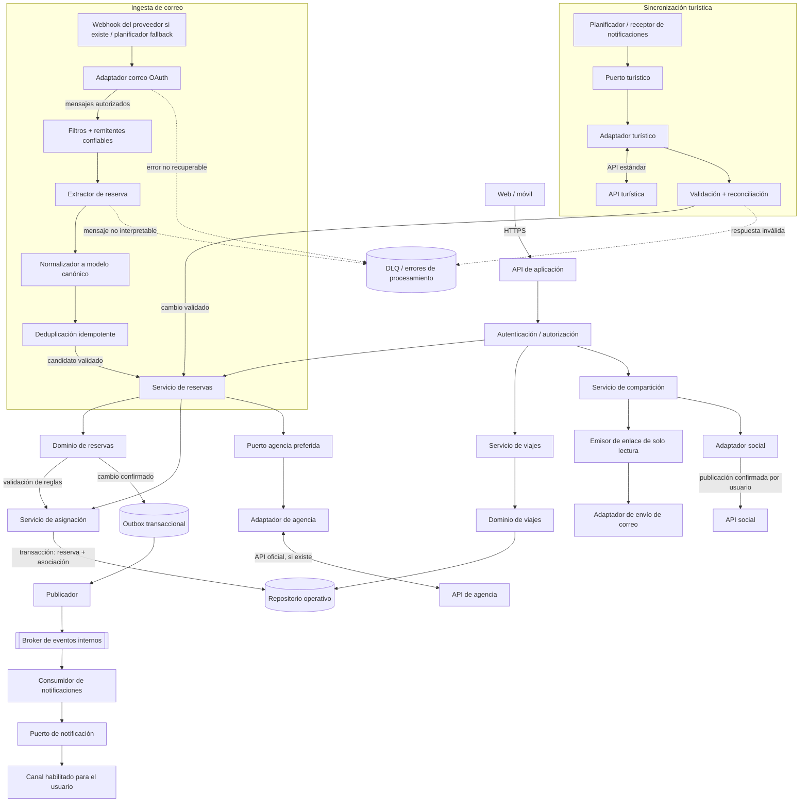

# Vista C&C — funcionalidad central (ADD-2)

La vista refina los componentes del flujo de reservas y muestra las rutas principales para registro manual, importación desde correo, sincronización turística y compartición.

## Contratos y semántica

- Las acciones interactivas se responden por HTTPS; la ingesta y las notificaciones no bloquean la petición del usuario.
- La importación produce una **reserva candidata**. Solo después de validación y deduplicación se registra; no se inventa la asociación a un viaje.
- Las actualizaciones externas se reconcilian con el modelo canónico. La precedencia entre edición manual y datos externos sigue abierta y no se resuelve con “último evento gana”.
- Las escrituras publican eventos mediante outbox para evitar confirmar un cambio sin dejar registro de su evento pendiente.
- Los adaptadores de correo, turismo y agencia ocultan detalles del proveedor. La integración directa de agencia depende de una API compatible y autorizada.
- DLQ, alertas y reproceso deben tener responsables y límites de retención; los fallos no deben borrar la última información válida.
