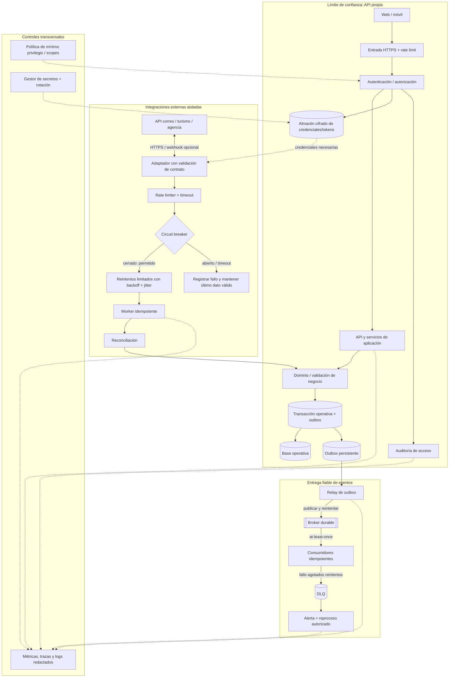

# Vista de resiliencia y seguridad — ADD-3

## Invariantes y decisiones operativas

- Tokens de correo nunca van en código, URLs ni logs; se cifran, se restringen por scope y se eliminan/revocan al desconectar la cuenta.
- Cada proveedor tiene límites de concurrencia y políticas de timeout/reintento propias; un circuito abierto no bloquea integraciones no relacionadas.
- Se conserva el último dato válido cuando una fuente falla; se marca el estado de sincronización y se alerta sobre antigüedad.
- Outbox evita perder el evento entre la confirmación de datos y su publicación. El broker puede entregar repetidos; consumidores idempotentes los toleran.
- DLQ no es un agujero negro: requiere alerta, retención, acceso limitado, causa visible y reproceso controlado.
- Los enlaces compartidos son de solo lectura, impredecibles, revocables y con expiración. La verificación del destinatario debe cerrarse antes del prototipo.
- La vista no prueba el SLO: deben medirse disponibilidad, latencia, backlog, errores de proveedores, recuperación y comportamiento bajo carga.
