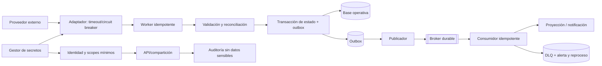

# Vista de resiliencia y seguridad — ADD-3

## Invariantes

- Tokens de correo nunca van en código ni logs.
- Entrega al menos una vez implica consumidores idempotentes.
- La falla de un proveedor no debe bloquear todas las integraciones.
- DLQ requiere retención, alertas y proceso de reproceso.
- El diagrama no prueba el SLO: debe verificarse mediante ensayos.
