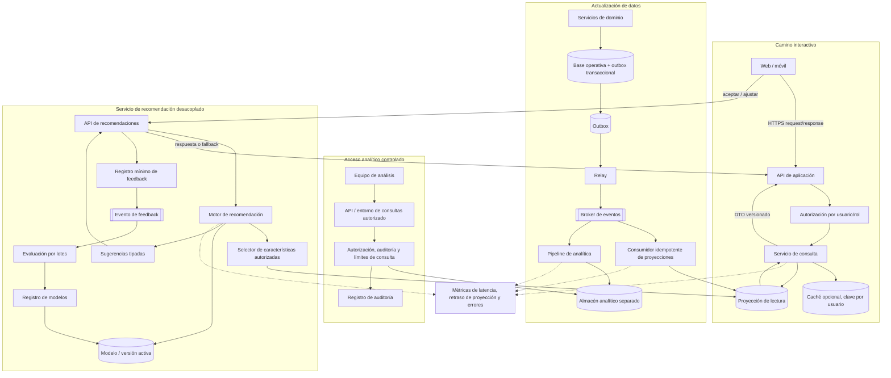

# Vista C&C de lectura, analítica y recomendaciones — ADD-4

## Contratos y límites

- La base operativa sigue siendo la fuente de verdad; las proyecciones pueden estar temporalmente atrasadas. El retraso debe medirse y el sistema debe mostrar datos conocidos sin fingir frescura.
- El camino interactivo no ejecuta consultas analíticas pesadas. Las consultas del equipo pasan por autorización, límites y auditoría.
- La caché es opcional y se invalida/actualiza de forma explícita; nunca se comparte una entrada entre usuarios por una clave insuficiente.
- El recomendador usa un contrato versionado y el conjunto mínimo de datos autorizado. Si falla o excede su presupuesto, se conserva el acceso al itinerario.
- Aceptar una sugerencia no altera automáticamente una reserva: la modificación requiere una acción explícita del usuario.
- La evaluación del modelo es asíncrona y versionada; no se implica reentrenamiento inmediato por cada interacción.
