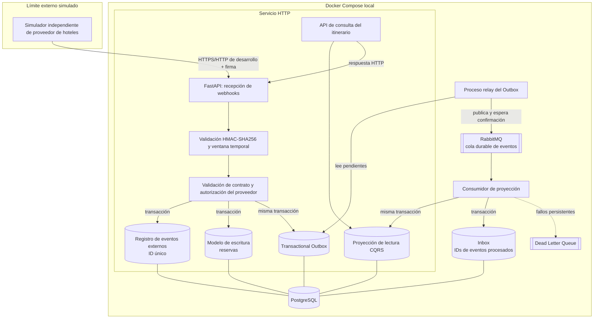

# Vista C&C del prototipo integrado — ADD-5

Esta vista concreta el prototipo de validación. Los procesos se separan en Docker Compose para poder detenerlos individualmente, aunque puedan compartir el mismo código fuente.

## Responsabilidades y contratos

- **Simulador:** genera eventos de alta, modificación y cancelación; permite repetir envíos, usar firmas inválidas y simular fallos.
- **FastAPI/webhook:** valida la firma sobre la marca temporal y el cuerpo original, valida el esquema y rechaza solicitudes no auténticas antes de ejecutar efectos de negocio.
- **Registro de eventos externos:** una restricción única sobre el ID del proveedor impide que la repetición del mismo webhook vuelva a ejecutar la operación.
- **Modelo de escritura + Outbox:** el cambio de la reserva y la creación del evento interno se confirman en la misma transacción PostgreSQL.
- **Relay:** publica los eventos pendientes a RabbitMQ y los marca publicados tras la confirmación del broker. Puede publicar más de una vez si se cae en la ventana entre ambos pasos.
- **RabbitMQ:** mantiene los mensajes en colas durables y enruta los fallos persistentes hacia la DLQ mediante una política explícita de reintentos limitados.
- **Consumidor + Inbox:** registra el ID procesado y actualiza la proyección de lectura en una transacción. Confirma el mensaje después del commit.
- **Proyección CQRS:** tabla o conjunto de tablas de lectura separadas del modelo de escritura, en el mismo motor PostgreSQL.
- **API de consulta:** lee la proyección; puede mostrar el estado previo durante la propagación eventual, pero no debe fingir que ya refleja el cambio.

## Escenarios de fallo que la vista permite ensayar

1. Repetición del mismo webhook externo.
2. Firma HMAC inválida o marca temporal fuera de la ventana permitida.
3. Caída del relay antes o después de publicar el evento.
4. Caída del consumidor antes del commit y recuperación posterior.
5. Reentrega del mismo evento interno.
6. Fallo persistente y llegada del mensaje a la DLQ.
7. Reproceso controlado de un mensaje de DLQ.

## Decisiones que no deben inferirse de la vista

- La existencia de un proveedor simulado no confirma la disponibilidad de una API real.
- Los procesos separados en Compose no obligan a que cada componente sea un microservicio independiente en producción.
- El uso de una sola instancia de PostgreSQL en el prototipo no invalida la separación lógica CQRS, pero tampoco prueba escalabilidad de producción.
- La entrega es al menos una vez; el diseño no promete entrega exactamente una vez.
- El control de eventos distintos que lleguen fuera de orden queda pendiente de una política explícita de versión/precedencia.
