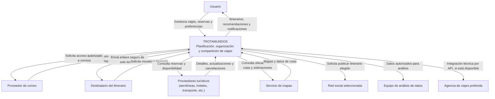

# Diagrama de contexto — Trotamundos

## Notas sobre el alcance
- El usuario autoriza y puede revocar el acceso al correo (RF-17/RF-18).
- Se prefieren notificaciones/webhooks de correo y proveedores turísticos cuando existan; la consulta periódica queda como alternativa según la API y sus cuotas.
- Los enlaces compartidos son de solo lectura; el destinatario puede no tener cuenta. Caducidad, revocación y verificación del destinatario deben definirse antes del prototipo.
- Las consultas a proveedores no implican que Trotamundos efectúe reservas automáticamente.
- El equipo de análisis solo accede a los datos necesarios para tareas autorizadas; se priorizan datos agregados/desidentificados cuando sean suficientes.
- RF-15 se diseña como integración técnica directa con la agencia preferida. La existencia y capacidad de la API quedan pendientes de validación en la etapa 5; no se asume que exista.
- Las APIs y proveedores concretos siguen pendientes de selección y validación.
