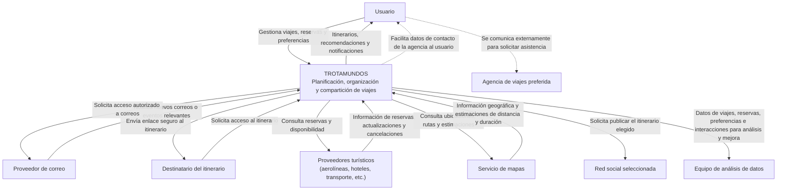

# Diagrama de contexto — Trotamundos

## Notas sobre el alcance

- El acceso al correo requiere autorización del usuario.
- Los enlaces compartidos deben restringir el acceso a los destinatarios designados. La autorización, caducidad y revocación quedan pendientes de diseño.
- Las consultas a proveedores turísticos no implican que Trotamundos realice reservas automáticamente.
- El equipo de análisis accede a los datos necesarios para sus tareas autorizadas. Se priorizan datos agregados o desidentificados cuando sean suficientes.
- La agencia no tiene integración técnica directa con Trotamundos: el usuario se comunica con ella por fuera del sistema.
- Las capacidades concretas de los proveedores externos quedan pendientes de selección y validación.